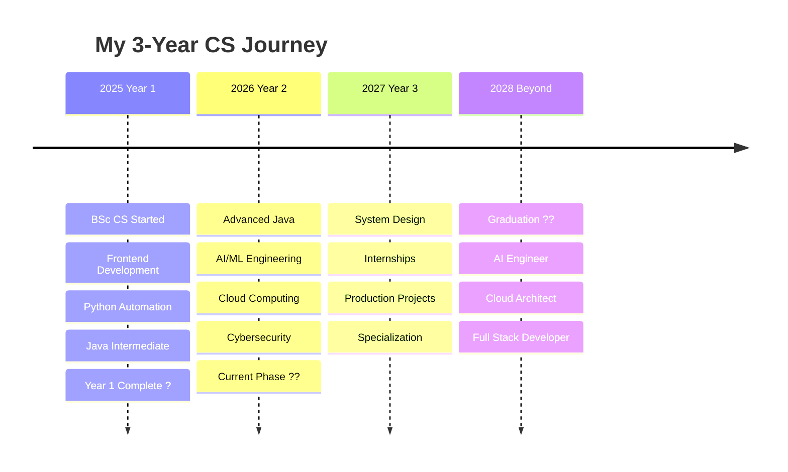

<div align="center">


<a href="https://git.io/typing-svg"></a>

<p>


</p>

<p>
<a href="https://linkedin.com/in/santoshmandal"></a>
<a href="mailto:santoshmandal2908@gmail.com"></a>
<a href="https://twitter.com/santoshmandal"></a>
</p>

</div>

---

## About Me


```yaml
name: Santosh Mandal
location: Nepal ????
education:
  degree: "BSc (Hons) Computer Science"
  journey: "2025 - 2028"
  current: "Year 2 (2026)"

role:
  - Full Stack Developer
  - AI/ML Engineer (Learning)
  - Cloud Enthusiast
  - Cybersecurity Explorer

learning_path:
  year_1_2025:
    status: ? Completed
    skills:
      - Frontend (HTML, CSS, JS, React)
      - Python Automation
      - Java Intermediate
      - Computing Fundamentals
      
  year_2_2026:
    status: ?? Current Focus
    topics:
      - Advanced Java & Spring Boot
      - AI/ML with TensorFlow
      - Cloud Computing (AWS, Azure)
      - Cybersecurity (Self-Study)
      
  year_3_2027:
    status: ?? Planned
    goals:
      - System Design
      - Real Internships
      - Production Projects
      - Full Specialization

motto: "From Nepal to the world - through code! ??"
```

<br clear="right"/>

---

## Tech Stack

### Frontend Development


### Backend Development


### Python & AI/ML


### Cloud & DevOps


### Databases


### Cybersecurity (Self-Study)


---

## GitHub Stats

<div align="center">
  
  
</div>

<div align="center">
  
</div>

---

## GitHub Trophies

<div align="center">

[](https://github.com/ryo-ma/github-profile-trophy)

</div>

---

## Activity Graph

[](https://github.com/ashutosh00710/github-readme-activity-graph)

---

## Learning Journey (2025-2028)

<div align="center">

</div>



---

## Current Goals (2026)

<table>
<tr>
<td width="50%">

### Academic Focus
- ?? Master Spring Boot & Microservices
- ?? Build AI/ML projects
- ?? Complete AWS fundamentals
- ?? Learn ethical hacking
- ?? Advanced DSA

</td>
<td width="50%">

### Career Goals
- ?? Build 10 production apps
- ?? Deploy 5 AI/ML models
- ?? Write technical blogs
- ?? Open source contributions
- ?? Target internship (2027)

</td>
</tr>
</table>

---

## Featured Projects

<div align="center">

</div>

<table>
<tr>
<td width="50%">

### Full Stack Web Apps
**React + Spring Boot**

- Responsive UI/UX
- REST APIs
- Microservices
- Cloud deployment

`React` `Spring Boot` `PostgreSQL` `AWS`

</td>
<td width="50%">

### AI/ML Projects
**Python + TensorFlow**

- ML models
- Data analysis
- Predictions
- API deployment

`Python` `TensorFlow` `PyTorch` `FastAPI`

</td>
</tr>

<tr>
<td width="50%">

### Cloud Applications
**AWS & Azure**

- Serverless architecture
- Container orchestration
- CI/CD pipelines
- Infrastructure as Code

`Docker` `Kubernetes` `AWS` `Terraform`

</td>
<td width="50%">

### Security Tools
**Kali Linux**

- Network scanning
- Vulnerability testing
- Automation scripts
- Penetration testing

`Kali Linux` `Python` `Metasploit`

</td>
</tr>
</table>

---

## Weekly Dev Breakdown

```text
Advanced Java (Spring Boot)                          70%
Frontend (React)                                     60%
Python & AI/ML                                       50%
Cloud (AWS/Azure)                                    40%
Cybersecurity (Self-Study)                           30%
DSA & Problem Solving                                50%
```

---

## Philosophy

<div align="center">


> **"Quality over quantity. Production-ready over practice!"**
>
> **"Learn by building. Build by learning."**
>
> **"From Nepal ???? to the world ?? - through code!"**

</div>

---

## Connect With Me

<div align="center">


### Let\'s Build Something Amazing!

<a href="https://linkedin.com/in/santoshmandal"></a>
<a href="mailto:santoshmandal2908@gmail.com"></a>
<a href="https://twitter.com/santoshmandal"></a>
<a href="https://github.com/santoshmandal2908-wq"></a>

### Open For

**Internships**   **Collaborations**   **Open Source**   **Freelance**   **Learning Together**

---

### From the Mountains of Nepal to Your Screen ?????

<h3>Thank you for visiting! ??</h3>
<h3>Let\'s code the future together! ??</h3>

</div>

---

<div align="center">
  
</div>

<div align="center">
  
  
  
</div>
