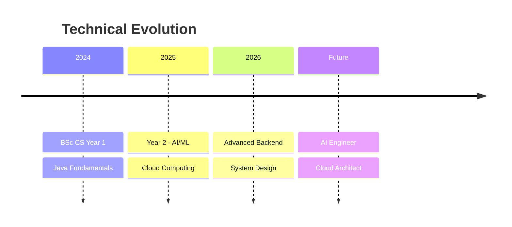

<div align="center">

# 👋 Hi, I'm Santosh Mandal!

[](https://git.io/typing-svg)

<p>
  
  
  
</p>

</div>

---

## 🚀 About Me

```yaml
name: Santosh Mandal
location: India
education: BSc (Hons) Computer Science - Year 2
role: Software Developer | AI Enthusiast | Cloud Explorer

current_focus:
  - Java Backend Development (Spring Boot, Microservices)
  - Python Automation & AI/ML Engineering
  - Full Stack Web Development
  - Cloud Computing (AWS, Azure)
  - Cybersecurity & Penetration Testing (Kali Linux)

learning_path:
  year_1: "Completed ✓ - Java Fundamentals, DSA"
  year_2: "Current → AI/ML, Cloud, Advanced Backend"
  year_3: "Planning → System Design, DevOps, Security"

motto: "Building production-ready solutions! 🚀"
```

---

## 💼 Core Competencies

### 🎯 Primary Stack
```java
public class Developer {
    String primaryLanguage = "Java";
    String[] frameworks = {"Spring Boot", "Hibernate"};
    String specialization = "Backend & Microservices";
    
    public void buildEnterprise() {
        design(); develop(); deploy(); scale();
    }
}
```

### 🔧 Technology Arsenal

#### **Languages & Frameworks**


#### **AI/ML & Data Science**


#### **Cloud & DevOps**


#### **Databases**


#### **Cybersecurity & Linux**


---

## 📊 GitHub Statistics

<div align="center">
  
  
</div>

<div align="center">
  
</div>

---

## 🏆 GitHub Trophies

<div align="center">

[](https://github.com/ryo-ma/github-profile-trophy)

</div>

---

## 📈 Contribution Activity

[](https://github.com/ashutosh00710/github-readme-activity-graph)

---

## 🚀 Featured Projects

### 💼 Professional Portfolio

<table>
<tr>
<td width="50%">

#### 🔹 Java Microservices Architecture
**Enterprise-grade backend system**

`Spring Boot` `Docker` `PostgreSQL`

- RESTful API Design
- JWT Authentication
- Microservices Pattern

</td>
<td width="50%">

#### 🔹 AI-Powered Automation
**Python automation & ML models**

`Python` `TensorFlow` `FastAPI`

- Web Scraping Framework
- ML Model Deployment
- Data Pipeline

</td>
</tr>

<tr>
<td width="50%">

#### 🔹 Full Stack Web App
**Modern responsive platform**

`React` `Node.js` `MongoDB`

- SPA Architecture
- Real-time Features
- Cloud Deployment

</td>
<td width="50%">

#### 🔹 Cybersecurity Toolkit
**Penetration testing utilities**

`Kali Linux` `Python` `Bash`

- Network Scanner
- Vulnerability Assessment
- Security Automation

</td>
</tr>
</table>

> 🔗 **Quality over quantity** - Building production-ready projects!

---

## 📚 Learning Journey



---

## 🎯 Current Goals (2026)

- 🔥 Build **10 production-ready projects**
- 🤖 Complete **AI/ML specialization**
- ☁️ Earn **AWS/Azure certifications**
- 🔐 Master **ethical hacking**
- 💼 Land **software engineering internship**

---

## 📫 Connect With Me

<div align="center">

[](mailto:santoshmandal2908@gmail.com)
[](https://linkedin.com/in/santoshmandal)
[](https://github.com/santoshmandal2908-wq)

</div>

---

## 💡 Philosophy

<div align="center">

> **"Quality over quantity. Production-ready over practice code."**
>
> **"Learn by building. Build to learn."**

</div>

---

## 📊 Weekly Development Focus

```text
Java/Spring Boot     ████████████░░░░░   60%
Python/AI-ML         ████████░░░░░░░░░   40%
Full Stack Dev       ██████░░░░░░░░░░░   30%
Cloud/DevOps         ████░░░░░░░░░░░░░   20%
Cybersecurity        ███░░░░░░░░░░░░░░   15%
```

---

<div align="center">

### ⚡ Open for collaborations on:
**Backend Development** • **AI/ML Projects** • **Open Source** • **Research**

---

### 🌟 **"Building the future, one commit at a time!"** 🌟

</div>

---

<div align="center">
  
</div>
